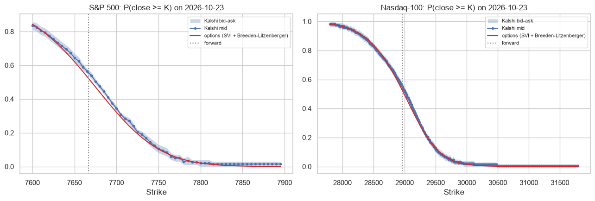
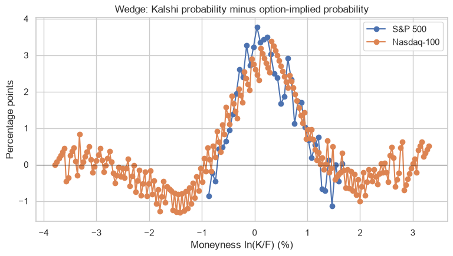

# Same state, two markets: S&P 500 options vs Kalshi event contracts

Part of my Graduating Project at Rennes School of Business. A Kalshi contract "S&P 500 at or above K at the close" pays 1 dollar in one state of the world. It is an Arrow-Debreu claim, or digital option. Listed options price the same claim implicitly: the slope of the call price across strikes is the risk-neutral probability of finishing above each strike (Breeden and Litzenberger, 1978).

For the same expiry (close of 23 October 2026) we compare two distributions:
- the one implied by the SPXW options, with an SVI smile fitted to the implied volatilities;
- the one quoted directly by the ladder of Kalshi contracts.

We repeat the comparison with the Nasdaq-100.

**Data:**
- Cboe SPXW and NDX options (Yahoo Finance).
- Kalshi public API (series KXINXU and KXNASDAQ100U).

It is a snapshot, saved in `data/`.

## Results
| | S&P 500 | Nasdaq-100 |
|---|---|---|
| Mean absolute gap (percentage points) | 1.6 | 0.8 |
| Kolmogorov-Smirnov distance | 0.038 | 0.034 |
| Option price inside the Kalshi bid-ask | 63% of strikes | 90% of strikes |

- The two markets give almost the same distribution. The gap is smaller than the cost of trading it (the Kalshi half spread is about 2 points), so most of it cannot be arbitraged.
- The gap is not random. On the S&P 500, Kalshi is above the options around the money (up to +3.4 points): Kalshi traders put a little more probability on the index finishing higher.
- The distance between the two distributions is the panel variable I propose for the thesis. The next step is to build it every day.




## How to run
```
pip install -r requirements.txt
jupyter notebook spx_options_vs_kalshi.ipynb
```

---
Alejandro Lezcano Osorio | Rennes School of Business (MSc in Financial Data Intelligence) and Universidad EIA
